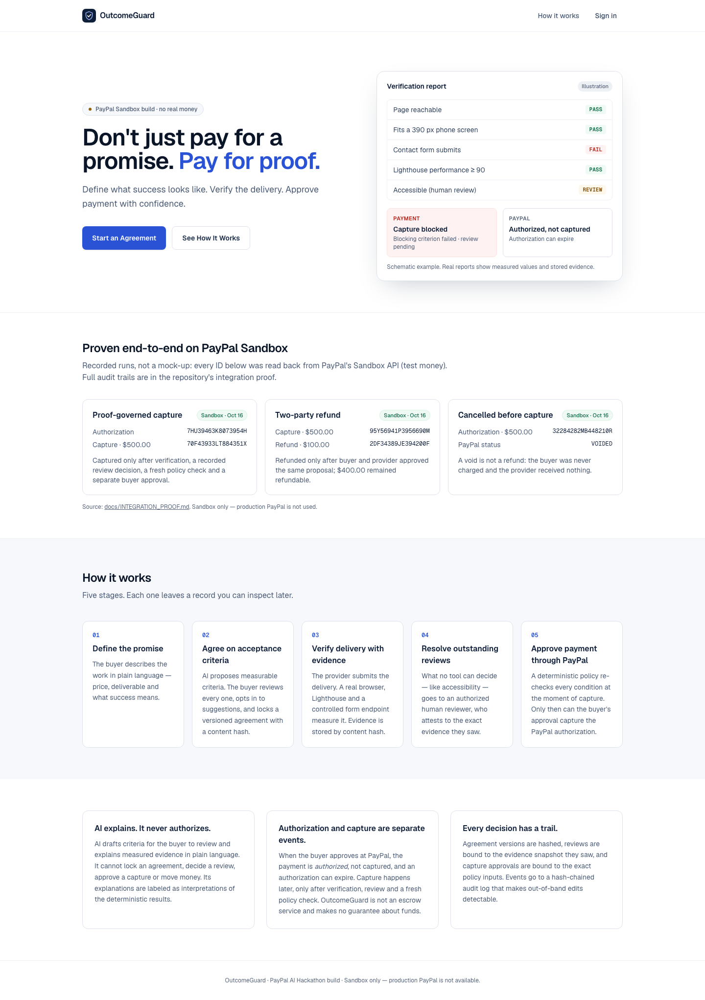
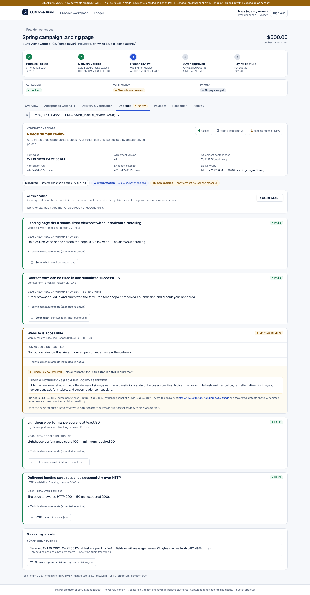
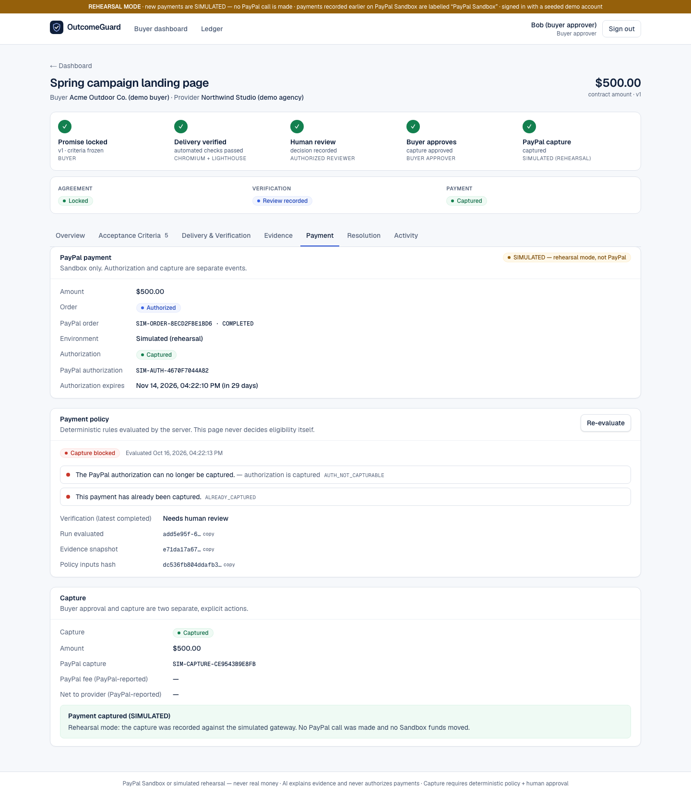
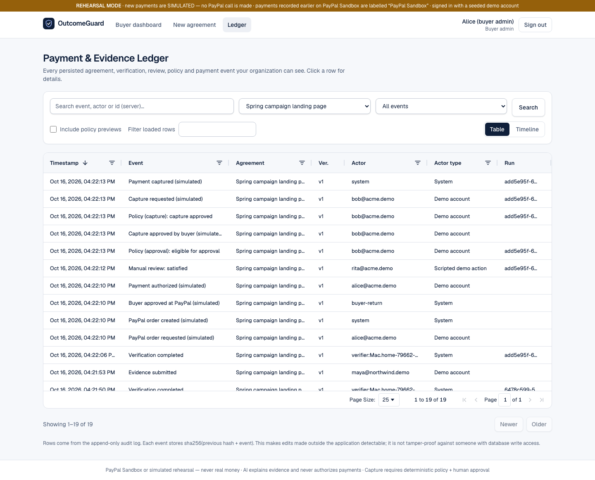

# OutcomeGuard

### Don't just pay for a promise. Pay for proof.

OutcomeGuard lets a business pay a freelancer through PayPal **only when the delivered work
is proven**. The buyer describes the job in plain English; **AI** turns it into measurable
acceptance criteria; **real tools** (a Chromium browser, Google Lighthouse, a controlled
form endpoint) verify the delivery; **authorized humans** make the calls no tool can make;
and **PayPal** captures the authorized payment only when a deterministic policy — re-checked
at the moment of capture — says yes.

```
AI drafts criteria & explains evidence → deterministic tools verify → humans approve → PayPal executes
```

Built for the [PayPal AI Hackathon 2026](https://paypalaihackathon.devpost.com/). **PayPal
Sandbox only — no real money.** MIT licensed.

▶ **Demo video (2:16):** https://youtu.be/NC4gV5sbMEg

<p align="center"></p>

## Why it matters

Freelance and agency work runs on trust: either the buyer pays first and hopes, or the
provider works first and hopes. Disputes start from "it doesn't work" versus "it does" with
no shared, objective record. OutcomeGuard makes the acceptance criteria explicit up front,
measures the delivery against them with reproducible evidence, and ties the payment to that
evidence and to explicit human approvals.

## What is real (verified on PayPal Sandbox, Oct 16 2026)

| Flow | PayPal Sandbox IDs (read back from PayPal) |
|---|---|
| Proof-governed capture: verified delivery + recorded review + fresh policy check + separate buyer approval | authorization `7HU39463K8073954H` → capture `70F43933LT884351X` ($500.00) |
| Two-party refund: buyer and provider approved the same $100 proposal | capture `95Y56941P3956690M` → refund `2DF34389JE394200F` ($100.00, $400.00 remaining) |
| Cancellation before capture (void, not a refund) | authorization `32284282MB448210R` → `VOIDED` |
| Lost-response safety: capture response dropped on purpose, reconciled by reading PayPal (one POST) | capture `6A555091CM668061A` |

Full audit trails, actors (human vs scripted demo accounts), policy decisions and hash-chain
verification: **[docs/INTEGRATION_PROOF.md](docs/INTEGRATION_PROOF.md)**.

## How it works

1. **Define the promise** — buyer writes the request; Claude (`claude-sonnet-5-5`) proposes
   criteria. Every criterion quotes the buyer's words; "must" stays blocking; AI ideas are
   off-by-default suggestions. The buyer reviews and **locks** a versioned, hashed agreement.
2. **Verify the delivery** — the provider submits a URL. A worker runs a real Chromium
   (phone-sized layout, contact form submitted to a controlled test endpoint), Lighthouse
   (median near the threshold) and an HTTP check, through an SSRF-guarded egress proxy.
   Evidence (screenshots, reports, traces) is stored by content hash.
3. **Human decisions** — what no tool can measure (e.g. accessibility) goes to an authorized
   reviewer who attests to the exact evidence snapshot.
4. **Pay** — PayPal Orders v2 `intent=AUTHORIZE`. A pure, deterministic policy decides
   eligibility; the buyer approves; the server re-evaluates under a row lock and captures
   with an idempotent `PayPal-Request-Id`. Uncertain outcomes are reconciled by reading
   PayPal first — never by sending a second payment.
5. **Resolve** — a case bound to the evidence; refunds only when both parties approve the
   same proposal; voids before capture.

**Roles of AI, tools, humans and PayPal never blur:** AI drafts and explains (its
explanations are grounded against stored measurements); it cannot lock, review, approve or
move money. The policy is plain code. Humans approve. PayPal executes.

## Screenshots (running app)

| Evidence report | Payment policy & capture | Ledger (AG Grid) |
|---|---|---|
|  |  |  |

Captured in **rehearsal mode** (payments SIMULATED, labelled in the UI). Real Sandbox
screenshots of the refund flow: [`docs/p08/sandbox/`](docs/p08/sandbox/).

## Architecture

```
apps/web   Next.js 16 · TypeScript · Tailwind 4 · AG Grid Community   (BFF: HttpOnly session cookie, CSRF check)
   │ same-origin /api/og/*
apps/api   FastAPI · Pydantic v2 · SQLAlchemy 2 · Alembic · PostgreSQL
   ├─ PayPal Orders v2 / Payments v2 (Sandbox) — authorize, capture, refund, void, webhooks
   ├─ Anthropic API (Claude) — criteria drafting, evidence explanation (budget-capped, grounded)
   ├─ policy (pure functions) — capture, refund, void decisions persisted with inputs hashes
   └─ verification worker — Chromium (Playwright) + Lighthouse behind an egress proxy
```

Details: [ARCHITECTURE](docs/ARCHITECTURE.md) · [PayPal integration](docs/PAYPAL_INTEGRATION.md) ·
[AI](docs/AI_VERIFICATION.md) · [Verification](docs/VERIFICATION.md) ·
[Payment governance](docs/GOVERNANCE.md) · [Resolution & refunds](docs/RESOLUTION_AND_REFUNDS.md) ·
[Security](docs/SECURITY.md).

## Run it locally

Requirements: macOS or Linux, Python 3.12+, [uv](https://docs.astral.sh/uv/), Node 22,
PostgreSQL 15+.

```bash
git clone https://github.com/datAgent77/outcomeguard && cd outcomeguard
cp .env.example .env
#   set: SESSION_SECRET and SINK_SECRET (any long random strings), DEMO_PASSWORD (you choose),
#        VERIFIER_DEV_ALLOW=127.0.0.1:8020,127.0.0.1:8010
#   optional: ANTHROPIC_API_KEY (AI drafting/explanations), PAYPAL_CLIENT_ID/SECRET (Sandbox)
createdb outcomeguard
(cd apps/api && uv sync && uv run alembic upgrade head && uv run playwright install chromium)
(cd apps/api/verifier-tools && npm ci)          # pinned Lighthouse
(cd apps/web && npm ci && npm run build)

scripts/demo/start.sh                            # API :8010 (rehearsal mode), worker, fixtures :8020, web :3010
DEMO_PASSWORD=… uv run --directory apps/api python scripts/prepare_demo.py --ready
open http://localhost:3010                       # sign in as alice@acme.demo with your DEMO_PASSWORD
```

- **Rehearsal mode (default for the demo)** needs no PayPal credentials: payments are
  SIMULATED, every id starts with `SIM-`, and the UI says so in an orange banner.
- **Real PayPal Sandbox:** create a free app at [developer.paypal.com](https://developer.paypal.com/),
  put its Sandbox client id/secret in `.env`, start with `PAYMENT_MODE=sandbox scripts/demo/start.sh`
  and approve with a **Sandbox buyer account**.
- **Without an Anthropic key** the AI wizard reports that no AI provider is configured;
  `prepare_demo.py` still creates a fully verified agreement with the canonical criteria.
- Demo accounts (password = your `DEMO_PASSWORD`): `alice@acme.demo` buyer admin,
  `bob@acme.demo` buyer approver, `rita@acme.demo` reviewer, `maya@northwind.demo` provider,
  `eve@globex.demo` unrelated buyer.

Three-minute walkthrough: [docs/hackathon/GOLDEN_DEMO.md](docs/hackathon/GOLDEN_DEMO.md).
(`docker compose` files exist, but the full container stack is not verified end to end — use
the steps above.)

## Tests

```bash
cd apps/api && createdb outcomeguard_test && uv run pytest              # 420 tests: mocked PayPal + real browser checks
cd apps/web && npm run lint && npm run typecheck && npm run test:e2e    # 47 browser tests (mocked API)
```

CI runs both on every push. Opt-in suites run against real PayPal Sandbox (`-m sandbox`) and
the real model (`-m ai_live`).

## Security boundaries (honest summary)

- Sandbox only; production PayPal is refused by configuration. No secrets in the repo.
- The browser never holds an API token (BFF with HttpOnly SameSite cookie + CSRF check).
- Money moves only through: fresh deterministic policy + separate human approval + row lock +
  idempotent PayPal request + read-first reconciliation. Database triggers enforce the bindings.
- AI and service accounts cannot review, approve, refund, void or capture (tested).
- The verifier reaches only public addresses (a development allow-list covers the local fixtures).
- Known limitations and open debt are listed, not hidden: [KNOWN_LIMITATIONS](docs/KNOWN_LIMITATIONS.md),
  [TECH_DEBT](docs/TECH_DEBT.md). This is a hackathon build, not a certified payment product;
  it is not an escrow service and not a replacement for PayPal disputes.

## License

[MIT](LICENSE)
